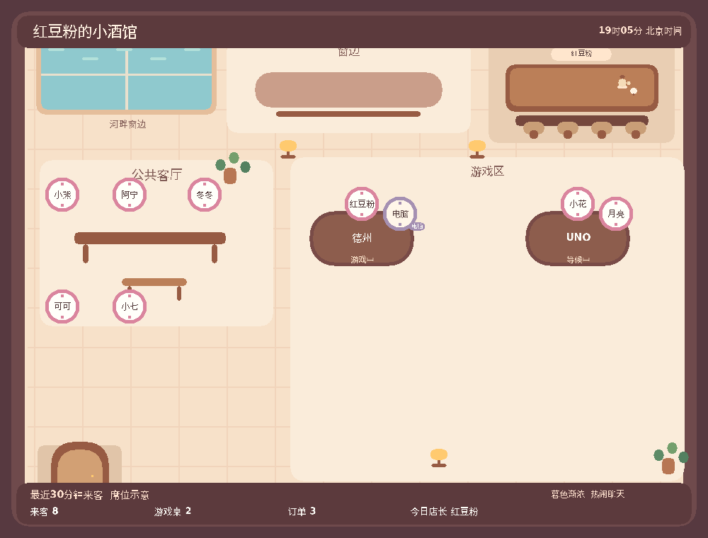

# 酒馆地图 · beta.34

本批只做地图。菜单扩充随后，生图与菜品云端图片方案最后；用户明确要求一个一个完成。

- 入口：大厅「店内地图」，公开PNG实况；图下刷新、去吧台、去游戏区、添置陈设、返回大厅。私密大厅内返回/地图保持可见性，公共地图无钱包与口味资料。
- 客流定义：最近30分钟使用酒馆按钮/菜单点单与公开牌桌活动的不同真人账号。不是Discord在线列表、语音在线或实际占座。昵称筹码示意分区，游戏桌真人优先，订单来客在吧台；机器人标电脑，不计真人。首次上线不回填30天候选或历史在线状态。
- 本服跨频道共用地图数据，独立于其他服务器；最多返回40位来客及8桌，图上最多4桌，显示真实总数及溢出摘要。30分钟外来客和过期桌况消失；关闭墓碑阻止旧快照复活，旧epoch不能关闭新桌。
- 新地图数据表用已有酒馆SQLite DO，公开快照只含游戏/阶段/玩家昵称与电脑标记；手牌、牌堆、余额、私人口味、消息token不进快照。桌况与参与者touch同事务，访问按60秒节流。
- 各频道DO在实际交互与桌况变化后生成公开快照，以一个持久outbox合并2秒发送；最多3次退避重试，失败后休眠至下一实际事件。复用原alarm，不增加Cron或轮询；被动alarm不延长无变化桌况的客流时间。
- 地图PNG用原牌桌Canvas/字体系统，1000×760，河窗昼夜/灯光按北京时间，热闹程度按真实客流。基础家具用木凳，额外陈设来自实际装修；不凭空画已购置沙发。
- PNG在酒馆DO按当前分钟与实际数据签名缓存一张，变化后重绘；交互Worker只负责上传小PNG附件。样例繁忙PNG约23.6KB，Node一次渲染CPU约62ms（粗估，不是线上承诺）。无AI调用。刷新不会连续推新消息，离开地图清除附件。
- 更新旧公共大厅即可获得地图按钮；此版本不主动将所有旧消息全服重发，也不写生产模拟桌/钱包。

图为模拟来客/牌桌的演示，非生产人数；实际机器人按本服活动生成地图。后续菜品与生图工作不属于本地图实现。
