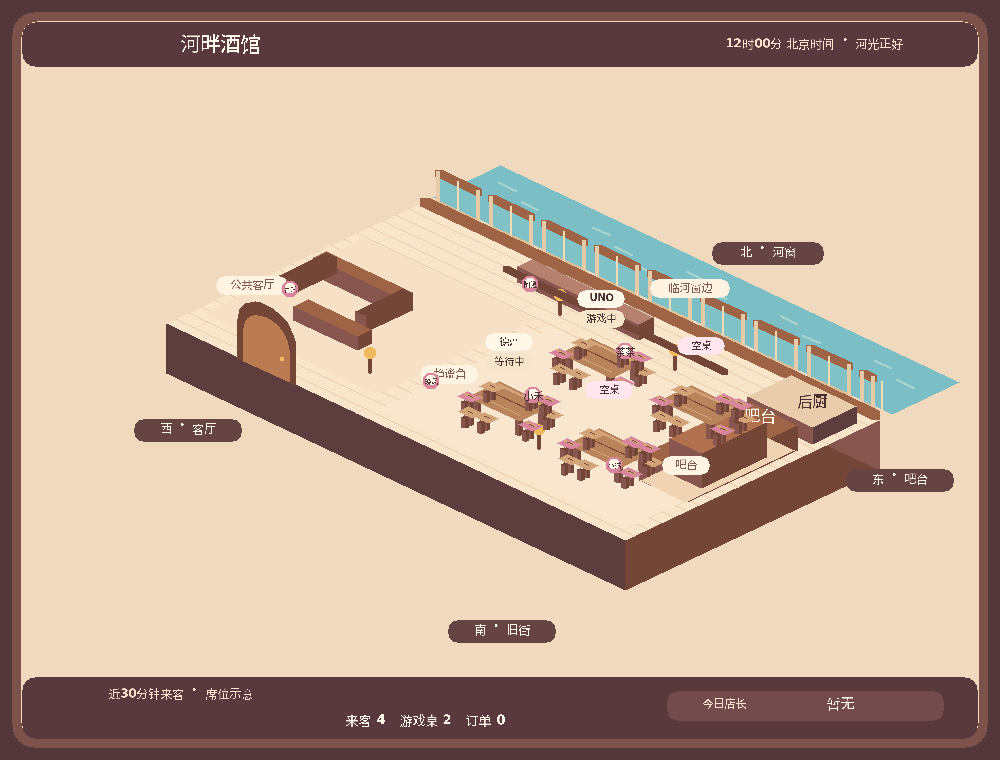

# 酒馆动态地图 · beta.40

大厅和“店内地图”共用程序实时快照和固定等距建筑，不调用模型绘制。建筑布局、投影、材料、装修锚点和未来生成图片规则见[TAVERN_BUILDING_SPEC.md](TAVERN_BUILDING_SPEC.md)；唯一空间数据源为tavern-building.mjs。

- 入口：/酒馆 大厅或@红豆粉“打开酒馆”。大厅以地图为主图，HUD显示近30分钟客流、桌况、店长、研发、活动和建设。原点单、游戏、装修、钱包、常客卡和经营按钮保留；私人服务保持本人可见，离开地图清除场景附件。
- 固定格局：北河长窗、南街拱门、东吧台/后厨、西客厅、东南四桌。空桌明确标注；24个装修ID及等级对应固定锚点，只画真实已购陈设。北露台与东附楼预留供以后扩建，不能画成已拥有区域。
- 默认四帧GIF循环河面微光、灯光轻闪和已购茶台热气；1000×760，首帧全图，后三帧更新局部。北京06:00日景、17:00暮景、20:00夜景。环境动画不代表人物持续移动或新的真人来访；快照直到事件/到期刷新才改变。
- 客流是近30分钟实际酒馆交互、真实@聊天和公开牌桌活动，不是Discord在线名单；区域由实际操作决定，区域内席位仍是示意。机器人不计真人，牌桌玩家与普通来客去重。公开资料只用昵称、游戏、阶段、电脑标记和实际装修冠名，不含手牌、牌堆、余额、口味偏好或消息token。
- 位置：大厅「换个位置」打开本人私密选择，支持客厅、吧台、窗边、安静角落；点单/菜单与成功订单前往吧台，常客卡明确选择常坐位置时同步区域。浏览钱包、常客卡、口味设置、聊天、刷新大厅和地图不会挪位。实际活跃牌桌成员优先显示在对应桌边，离桌/关桌/过期后恢复保存的区域；打开游戏列表不等于加入牌局。位置单独持久化，重启不丢；30分钟客流到期后暂不显示，回来延用所选区域。GIF不播放人物走路。
- 四个牌桌槽位稳定绑定频道与桌epoch，其他桌更新不会交换位置；关闭或过期释放，溢出用真实人数汇总。新旧SQLite数据兼容，旧访客默认客厅。位置变更参与公开签名，2秒合并更新原大厅消息，选择窗只有本人可见、不创建钱包。
- 本服跨频道共享地图，独立于其他服务器；返回最多40来客、8桌，图上最多4桌并说明溢出。关闭墓碑阻止旧桌况复活，桌epoch隔离，访客touch按60秒节流，不回填虚假历史客流。
- mapRender默认保留旧PNG/base64契约；请求scene=true使用renderScene，返回scene={filename,mime,data}。renderTavernMap返回PNG字节，renderTavernScene返回{filename,bytes,mime}。大厅/地图使用_mapScene上传附件，兼容旧_mapImage；内部元数据不会发给Discord。
- 最多5条公开大厅被跟踪，实际变化2秒合并；changed仅计算公开数据签名，不生成GIF。flush在DO锁外渲染一次，多频道共享附件，并multipart PATCH替换原消息；403/404解绑，有界退避最多3次，失败休眠至下一真实事件。被动刷新不touch来客或建立钱包。
- alarm取真实来客/牌桌最早到期、北京零点、光照边界；MIN查询不受显示40来客上限影响。复用既有alarm/Cron，无每秒/每分钟地图轮询。公开签名涵盖实际HUD、昵称、区域、稳定桌槽、游戏阶段、装修和光照，PNG/GIF分别缓存。
- 完整回归与发布证据见PROJECT_STATE.md顶部。本地样例均为模拟数据，编码大小/本地耗时不代表线上CPU或延迟；Discord客户端、区域选择刷新及运行负载仍待真人验证。

图中来客、牌桌和装修冠名均为模拟样例，不是生产客流。白天与夜晚PNG见[预览说明](docs/TAVERN_LOBBY_PREVIEW.md)。菜单和既有菜品图保持原样；后续扩建先更新建筑源与规范。
