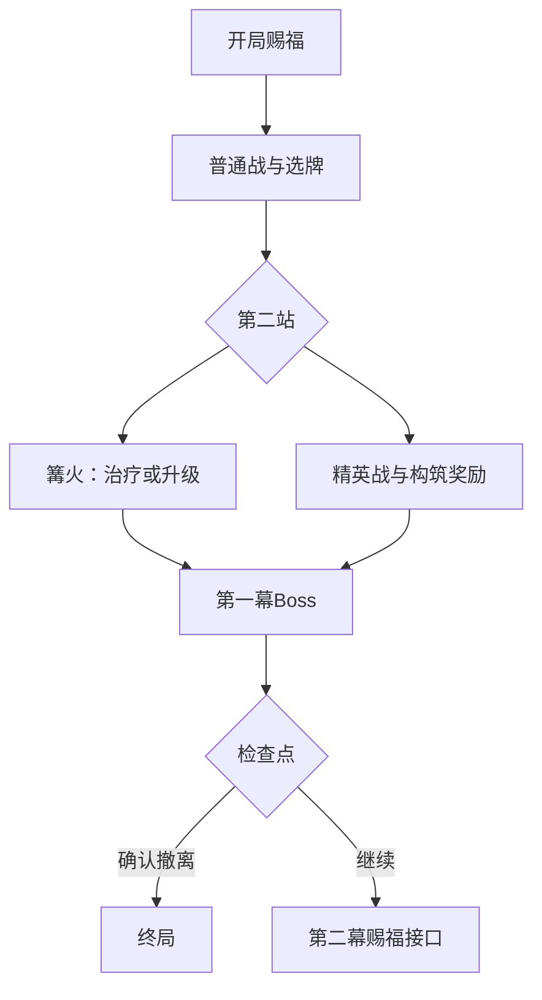

# 《灯下迷城》v0.2｜第一幕流程与手机界面

本稿是第一幕纸面/简化程序原型规格，依赖 [CONTENT_CONTRACT.md](CONTENT_CONTRACT.md) 与 [FIRST_ACT_CATALOG.json](FIRST_ACT_CATALOG.json)。不代表可上线版本；不在本批建立实际存档，也不扩写第二、三幕内容。

## 流程与阶段迁移

只允许下列前向迁移；每个界面仅接受当前阶段的合法操作。加载/恢复回到已保存阶段；阶段之外的旧按钮、重复请求均拒绝并提示刷新状态。

新局初始化 30/30 HP、8张初始牌及独立 `runId`。`BLESSING_ROOM` 是初始赐福房：余温火绒、门廊扣、旧巡夜徽章三选一或跳过，不占路线站。`ROUTE_1` 两支都进入教学普通战，分别为灯鼠/灰烬守卫；选择后只锁定 `selectedSlot`，不增加完成数。胜利进入固定余烬与卡牌奖励。`ROUTE_2` 二选一：篝火回复 9 HP（不超上限）或升级一张未升级实体牌；篝火处理完成即完成第2站；精英路线须战斗、卡牌奖励和遗物奖励全部处理完才完成第2站。两者都进入固定 Boss。Boss 胜利直接登记 +20 余烬并进入检查点，完成第3站，不另设选择型 Boss 奖励页；继续只打开第二幕赐福接口占位，第二幕实际内容未完成；确认撤离直接结束本局，不预领第二幕内容。

**路线计数：**界面显示“已完成 0/3 · 当前第1站”。选路仅锁定 `selectedSlot`；完成普通战并处理卡牌奖励后为“已完成 1/3 · 当前第2站”。完成篝火处理，或完成精英战并处理卡牌、遗物奖励后为“已完成 2/3 · 当前Boss站”。Boss胜利、+20余烬登记后为“已完成 3/3”。跳过赐福或任一奖励都算已处理；初始赐福不计站。选择即锁定，不能返回改选。当前奖励队列按 `runId + stageId + rewardId` 记录生成内容与处理状态；每次领取先核对阶段、队列和状态，再一次性更新奖励/阶段。重复点击或重放请求返回“奖励已处理”，不得重复加余烬、卡牌或遗物。断线恢复应回到处理前或处理后完整状态，不暴露部分入账；这是设计要求，实际存档尚未实现。

## 战斗操作与奖励

每轮抽4张不同实体牌、2能量、最多主动打2张。牌面显示费用、自伤、效果、消耗/可重放标签；与真实交互按钮一致：费用不足、次数用尽、满血包扎时按钮禁用并写明原因。点击可用牌立即按牌面顺序结算并移动实体牌；回声重放免费且不计主动次数。第二张主动牌打出后，或已无合法可出牌时，自动弃置余手牌并执行敌意图；初批牌为1/2费，因此能量归零即无合法牌并自动结束。只有仍有合法牌时才显示“结束本轮”，主动结束后弃置余手牌并执行敌意图。两种结束均触发回合末效果；胜败立即停止后续结算。Discord 私密消息的信息层级：首行 HP/护盾/灼烧、能量与次数；其下敌人 HP/护甲/灼烧及本轮意图；附一张包含最多四张实际手牌的组合图，图下文字逐张列费用与效果，并提供对应真实牌按钮；底部显示战斗记录。每次操作重新编辑同一私密消息，不使用自定义滚动区域。

普通胜利固定 +8 余烬，随后卡牌3选1或跳过；精英固定 +14，卡牌3选1后遗物3选1；Boss固定 +20 后进入检查点。余烬是本局原型资源，不设商店消费，不带出副本、不兑换酒馆币，不应当作长期钱包。卡牌选取确认后不能重复；跳过也写入该队列步骤已处理。

## 房间画面与页面层级

| 房间/页面 | 原画场景方向（每房一句） | 首屏信息与主要操作 |
|---|---|---|
| 初始赐福 | 潮湿石巷尽头悬着一盏暖灯，三件遗物映出各自微光。 | 房名与简述 → 余温火绒/门廊扣/旧巡夜徽章效果 →「选择赐福」/「跳过」；已完成0/3。 |
| 路线槽1 | 分岔巷道被一条摇晃灯绳隔开，左右尽头各有敌影。 | 已完成0/3·当前第1站 → 两条普通战支路与敌人预览 →「进入此路」；只锁定选择。 |
| 普通战斗 | 旧街摊棚被灰烬覆盖，灯鼠在灯下探头，或守卫堵住窄门。 | HP/资源 → 敌人/意图 → 实际手牌组合图（最多四张，不足时少展示）与逐牌按钮；有合法牌时可主动结束。 |
| 普通奖励 | 战后灯火落在散开的牌与一小堆温热余烬上。 | +8余烬已入账 → 三张牌完整效果 →「选此牌」/「跳过」；处理后1/3。 |
| 路线槽2/篝火 | 巷尾火盆照亮一张可歇息的石凳与摊开的旧牌。 | 已完成1/3·当前第2站 →「治疗 9」或「升级一张牌」；升级列表只显示未升级牌。 |
| 精英战与奖励 | 地下拱门前，余烬骑士拖着长影蓄势；战后护甲裂片露出三件遗物。 | 已完成1/3 → 敌人意图；胜利后依序 +14、选牌/跳过、选遗物/跳过；处理后2/3。 |
| Boss战 | 无灯大厅中央，执炬者站在倒悬灯盏下，火光照不到脸。 | HP/资源、Boss意图、实际手牌组合图（最多四张，不足时少展示）与逐牌按钮；败北进结果，胜利+20并完成3/3。 |
| 检查点/结果 | 灯下石碑刻着本幕结局，远处第二盏灯仍未点亮。 | 完成本幕记录 →「继续」/「确认撤离」；撤离须二次确认，之后结束本局。 |

**手机短文案示例**

- 「余温火绒：每场首次攻击造成生命伤害后，令敌人灼烧 2。」
- 「还可出 1 张；能量 1/2。仍有可出牌，可主动结束本轮。」
- 「绷带：满血时无法使用。」
- 「已完成 1/3 · 当前第2站；选定后不能返回。」
- 「奖励已处理。本轮进度已更新。」

## 终局与未验证项

撤离确认后本局进入终局 `RESULT`，不生成第二幕奖励。支付失败也进入终局 `RESULT`，可从结果页新开一局；新局必须生成全新 `runId`，旧局牌组、余烬、队列和检查点均不可串入。本文仅规定隔离行为，没有实现支付、实际存档或结算服务。第二、三幕仅保留章节骨架/后续接口，内容、敌人、奖励、数值与可玩性均未完成；首批数值仍待演算验证。
